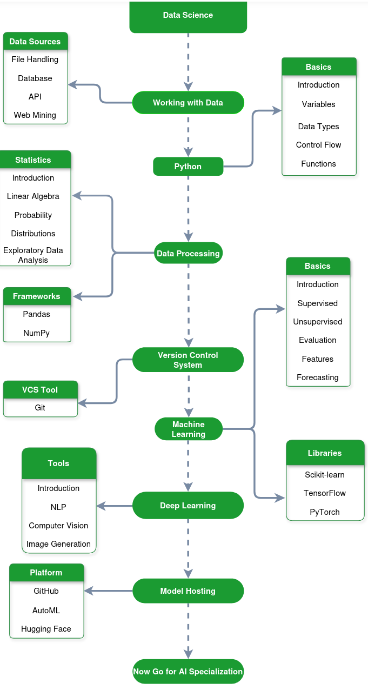

# GeeksforGeeks - Data Scientist Roadmap

A Data Scientist is a professional who analyzes and interprets complex data to extract meaningful insights and support data‑driven decision‑making. The flow in the roadmap starts with understanding data sources and programming, then moves toward statistics, machine learning, and deep learning.

## Data Sources

The roadmap begins with Data Sources, which represent where datasets are collected from before analysis or model building.

- ***\*File Handling\****: Reading datasets from files such as CSV or Excel.
- ***\*Database\****: Retrieving structured data stored in databases.
- ***\*API\****: Collecting data from online services.
- ***\*Web Mining\****: Extracting data from websites.

Understanding these sources helps data scientists gather the data needed for projects.

## Python Basics

Before moving into advanced topics, learners need to understand basic Python programming concepts.

- ***\*Introduction\****: Basic syntax and structure of Python.
- ***\*Variables\****: Used to store values.
- ***\*Data Types\****: Different forms of data such as numbers, lists, and dictionaries.
- ***\*Control Flow\****: Conditions and loops to control program execution.
- ***\*Functions\****: Reusable blocks of code.

These fundamentals help in writing scripts for data processing and modeling.

## Statistics

Statistics is essential in data science because it helps understand patterns and relationships in data.

- ***\*Introduction\****: Basics of statistical analysis.
- ***\*Linear Algebra\****: Mathematical concepts used in machine learning algorithms.
- ***\*Probability\****: Measures the likelihood of events.
- ***\*Distributions\****: Shows how data values are spread.
- ***\*Exploratory Data Analysis (EDA)\****: Examining data to understand patterns and insights.

## Data Processing

Once statistics concepts are clear, the next step is Data Processing, where datasets are prepared before training models.

Key tasks include:

- Data cleaning and preparation
- Handling missing values
- Transforming and organizing datasets

Frameworks commonly used for this stage include:

- ***\*Pandas\****: Used for structured data manipulation.
- ***\*NumPy\****: Used for numerical computations.

## Version Control System

The roadmap then introduces Version Control Systems, which help track changes in code and collaborate with teams.

- ***\*Git\****: Tracks code changes and manages project versions.

## Machine Learning

After preparing data, the next stage is Machine Learning, where algorithms are trained to learn patterns from data.

- ***\*Introduction\****: Overview of machine learning methods.
- ***\*Supervised Learning\****: Models trained using labeled data.
- ***\*Unsupervised Learning\****: Models that detect patterns without labels.
- ***\*Evaluation\****: Measuring model performance.
- ***\*Features\****: Selecting relevant variables for training.
- ***\*Forecasting\****: Predicting future outcomes.

Libraries used for machine learning include:

- Scikit-learn
- TensorFlow
- PyTorch

## Deep Learning

Deep learning is an advanced area of machine learning that uses neural networks to learn complex patterns.

- ***\*Natural Language Processing (NLP)\****: Understanding text and language.
- ***\*Computer Vision\****: Analyzing and interpreting images.
- ***\*Image Generation\****: Creating images using deep learning models.

## Model Hosting Platforms

After building models, the final step is deploying and hosting them so they can be used in real-world applications.

- ***\*GitHub\****: Used for sharing and managing code repositories.
- ***\*AutoML platforms\****: Tools that automate model building.
- ***\*Hugging Face\****: A platform for hosting and sharing machine learning models.

## Move Toward AI Personalization

Once learners understand:

- Data collection
- Statistics and data processing
- Machine learning models
- Deep learning techniques

# Reference

- [GeeksforGeeks - Data Scientist Roadmap](https://www.geeksforgeeks.org/blogs/data-scientist-roadmap/)