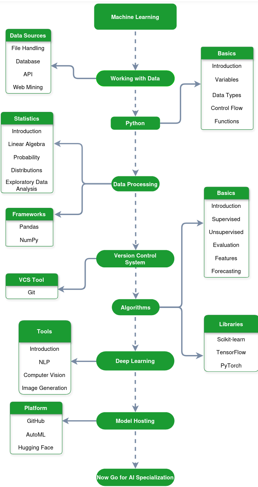

# GeeksforGeeks - Data Scientist Roadmap

A Machine Learning Engineer is a professional who designs, builds and deploys machine learning models into real-world applications to solve practical problems at scale. The flow in the roadmap starts with programming and data handling, then moves toward statistics and machine learning, and finally focuses on model deployment, optimization and production systems.

# Reference

- [GeeksforGeeks - Machine Learning Roadmap](https://www.geeksforgeeks.org/blogs/machine-learning-roadmap/)